# Evaluación 03 - Diseño de Interfaces de Programación Avanzado


Tres mini-proyectos en JavaScript: gestor de pedidos con DOM (**CaféTec**), refactorización a ES6+ con módulos y widget de clima con **fetch** y **async/await** (**ClimaTec**).

**GitHub Pages:** https://mateoazabache-art.github.io/evaluacion03-js/

## Tabla de contenidos

- [Pregunta 1: DOM, eventos y objetos](#pregunta-1-dom-eventos-y-objetos)
- [Pregunta 2: ES6+ y módulos](#pregunta-2-es6-y-módulos)
- [Pregunta 3: Fetch y async/await](#pregunta-3-fetch-y-asyncawait)
- [Diagrama del flujo de la Pregunta 3](#diagrama-del-flujo-de-la-pregunta-3)
- [Bitácora de IA](#bitácora-de-ia)
- [Checklist de entregables](#checklist-de-entregables)
- [Conclusión](#conclusión)

---

## Pregunta 1: DOM, eventos y objetos

Código en [`p1-dom/`](p1-dom/) · Documentación completa (tabla de eventos, XSS, delegación): [`documentacion-p1.md`](p1-dom/documentacion-p1.md)

| Elemento | Evento | Acción |
|---|---|---|
| `#form-pedido` | `submit` | Valida, crea el pedido y llama a `render()` |
| `#filtro` | `change` | Vuelve a dibujar según el estado elegido |
| `#lista-pedidos` | `click` (delegado) | Entregar o Eliminar según `data-id` |

Fragmento clave: **delegación de eventos** (un solo listener para todos los botones).

```js
lista.addEventListener("click", function (evento) {
  const boton = evento.target.closest("button[data-id]");
  if (boton === null) return;
  const id = Number(boton.dataset.id);
  if (boton.dataset.accion === "entregar") {
    pedidos.find(p => p.id === id).marcarEntregado();
  } else if (boton.dataset.accion === "eliminar") {
    pedidos.splice(pedidos.findIndex(p => p.id === id), 1);
  }
  render();
});
```

Fragmento clave: dibujar de forma **segura** con `textContent`.

```js
const texto = document.createElement("span");
texto.textContent = detalle; // el texto del usuario nunca se interpreta como HTML
li.appendChild(texto);
```

**Prueba de seguridad** con ``:

| Antes (`innerHTML`) | Después (`textContent`) |
|---|---|
| 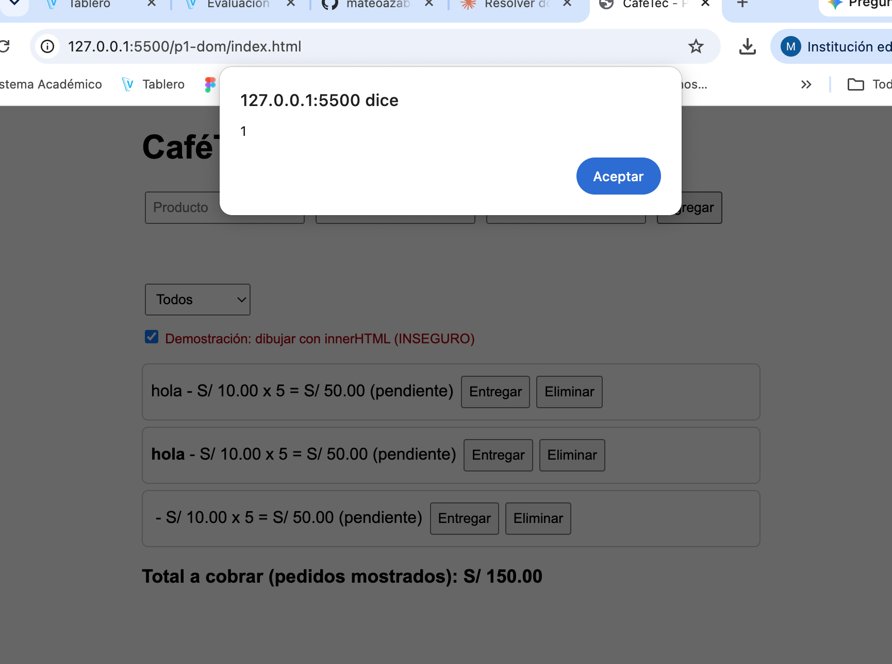 | 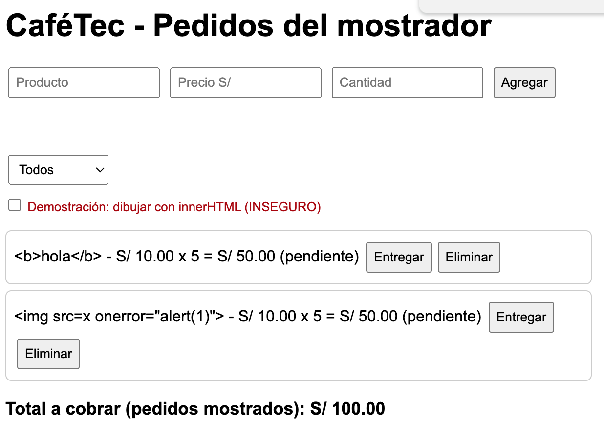 |

Página funcionando: 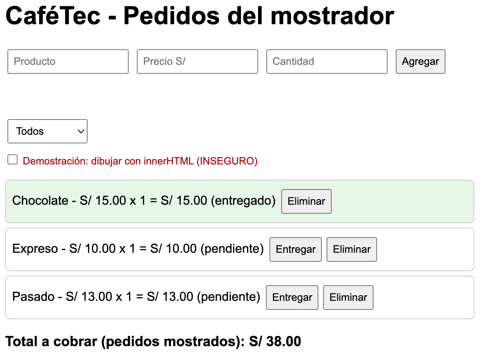

---

## Pregunta 2: ES6+ y módulos

Código en [`p2-modulos/`](p2-modulos/) · Cálculo manual, tabla ES6+, export y error `file://`: [`documentacion-p2.md`](p2-modulos/documentacion-p2.md)

**Error encontrado:** `cantidad || 1` convierte el `0` en `1`. El total antiguo daba **S/ 28.91** y el correcto es **S/ 23.60**. Se corrige con `??`.

```js
// pedidos.js
subtotal() {
  return this.precio * (this.cantidad ?? 1); // ?? respeta el 0
}

// Actualizar sin mutar el arreglo (spread)
export const marcarEntregado = (pedidos, id) =>
  pedidos.map((p) => (p.id === id ? new Pedido({ ...p, estado: "entregado" }) : p));
```

Error al abrir con `file://` (los módulos necesitan `http://`): 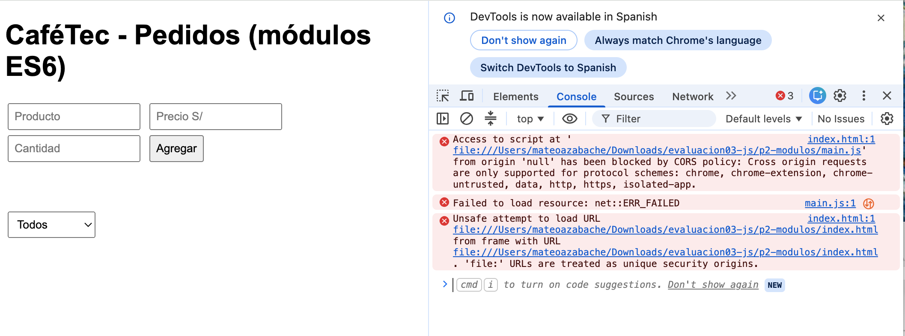

Funcionando con Live Server: 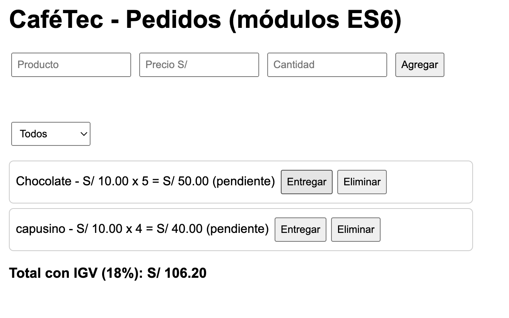

---

## Pregunta 3: Fetch y async/await

Código en [`p3-api/`](p3-api/) · Tabla de endpoints, tiempos, all vs allSettled: [`documentacion-p3.md`](p3-api/documentacion-p3.md)

```js
async function buscarCiudad(nombre) {
  const url = "https://geocoding-api.open-meteo.com/v1/search?name=" +
    encodeURIComponent(nombre) + "&count=1&language=es";
  const respuesta = await fetch(url);
  if (!respuesta.ok) throw new Error("Error " + respuesta.status); // fetch no falla con 404/500
  const datos = await respuesta.json();
  if (!datos.results) throw new Error("No se encontró la ciudad.");
  return datos.results[0];
}
```

| Cargando | Éxito | Ciudad no encontrada | Sin conexión |
|---|---|---|---|
| 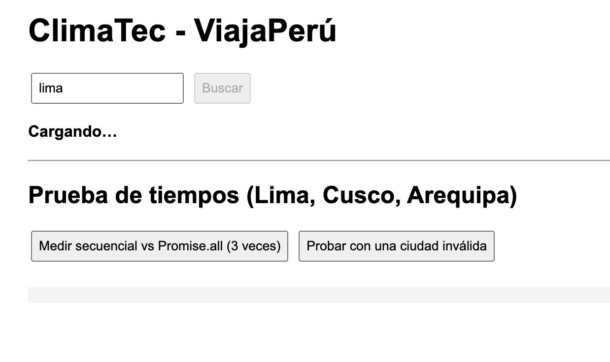 | 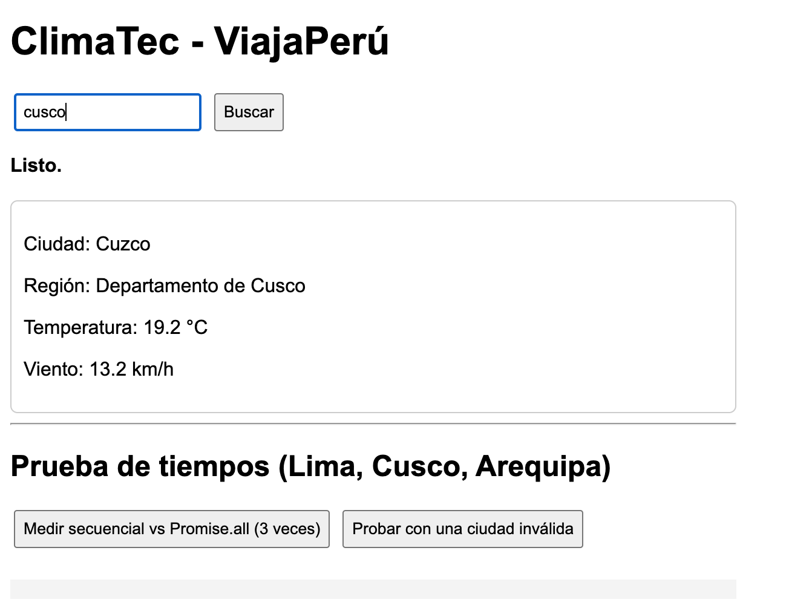 | 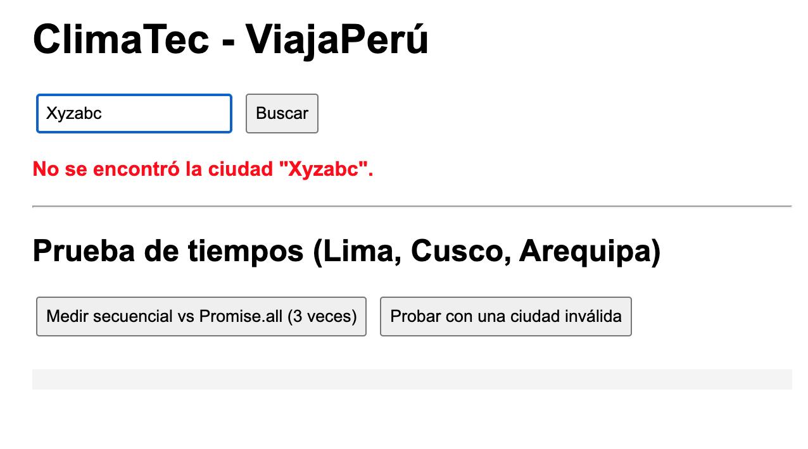 | 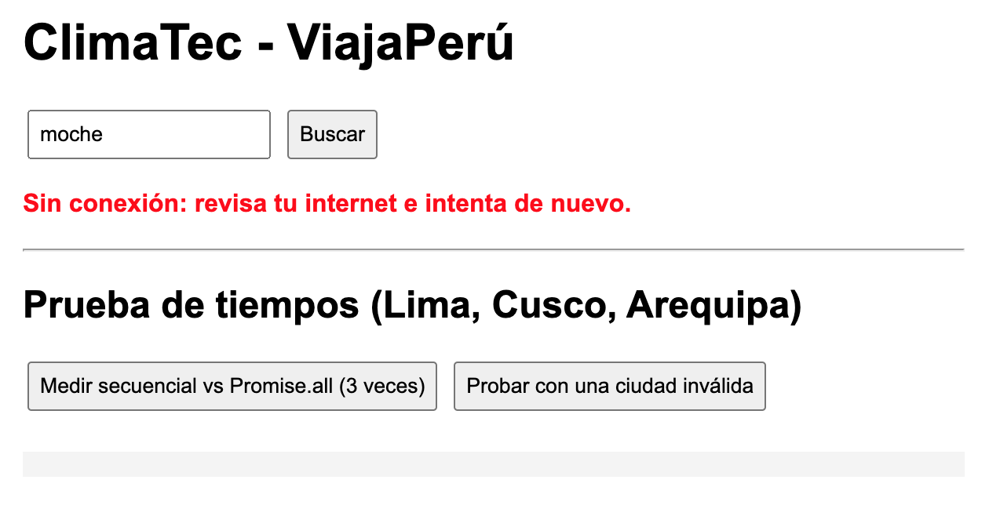 |

**Tiempos (secuencial vs. Promise.all):** ver tabla con mis mediciones en [`documentacion-p3.md`](p3-api/documentacion-p3.md#4-tiempos-secuencial-vs-promiseall-completa-con-tus-mediciones)

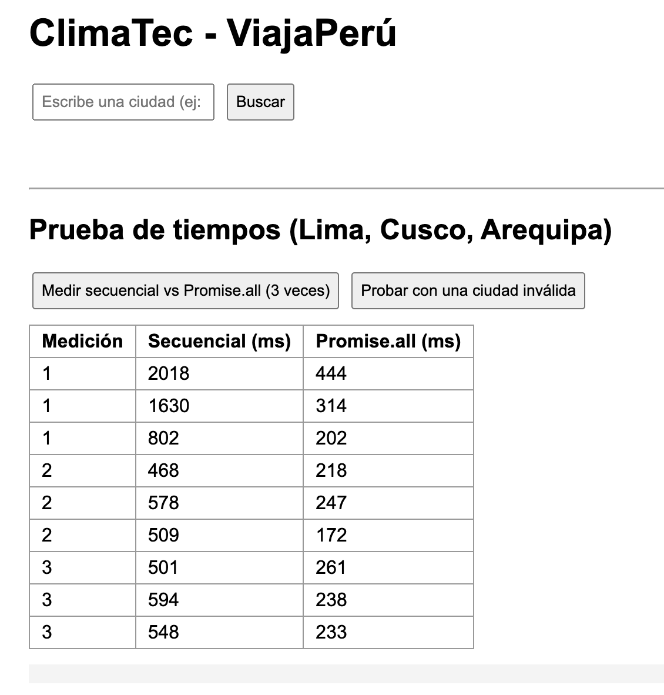

**Decisión:** `Promise.allSettled`, porque una ciudad inválida no debe tapar las demás.

---

## Diagrama del flujo de la Pregunta 3

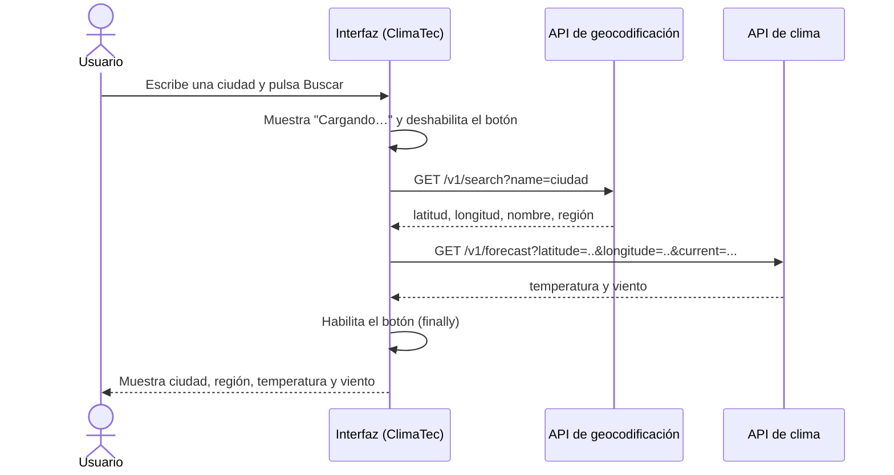

---

## Bitácora de IA

| # | Pregunta | IA usada | ¿Qué propuso la IA? | Decisión | ¿Por qué? |
|---|----------|----------|---------------------|:--------:|-----------|
| 1 | P1 | Claude | Función `render()` que vacía la lista, la redibuja desde el arreglo con `createElement` y `textContent`, y recalcula el total en cada llamada | Aceptó | Probé el texto ``: con `textContent` se ve como texto y no sale alerta. Agregué varios pedidos, entregué y eliminé, y el total siempre coincidió con mi cálculo a mano |
| 2 | P1 | Claude | Delegación con un solo listener y `closest("button[data-id]")` | Aceptó | Comprobé en el navegador que los botones creados después de cada `render()` siguen funcionando sin volver a agregar listeners |
| 3 | P2 | Claude | Refactor completo con `class Pedido`, módulos y `reduce()`, cambiando `\|\|` por `??` | Aceptó | Ejecuté `node prueba-total.js`: el total da 23.60, igual que mi cálculo a mano, y el código antiguo da 28.91 |
| 4 | P2 | Claude | `resumen()` seguía mostrando `xundefined` para el Jugo; se agregó `cantidad = 1` en la desestructuración | Corrigió | Lo vi en la salida de `codigo-antiguo.js` (`Jugo xundefined`) y verifiqué que ya sale `x1` |
| 5 | P3 | Claude | `buscarCiudad` y `obtenerClima` con `async/await`, `response.ok` y `current=temperature_2m,wind_speed_10m` | Aceptó | Revisé cada parámetro y campo en la documentación oficial de open-meteo.com y probé la ciudad "Xyzabc" y el modo Offline de DevTools |
| 6 | P3 | Claude | Usar `Promise.all` para las tres ciudades | Corrigió | Probé con una ciudad inválida: `Promise.all` perdía todo el resultado, así que dejé `Promise.allSettled` para el caso con fallos |

---

## Checklist de entregables

- [x] P1: código funcional en `p1-dom/`
- [x] P1: tabla de eventos y justificación de la delegación
- [x] P1: prueba de seguridad documentada
- [x] P1: capturas (funcionando, XSS antes y después)
- [x] P2: cálculo manual, código antiguo y refactorizado en `p2-modulos/`
- [x] P2: tabla de características ES6+ y justificación del tipo de export
- [x] P2: capturas (error con `file://` y Live Server)
- [x] P3: código en `p3-api/` y tabla de endpoints
- [x] P3: capturas (cargando, éxito, no encontrada, sin conexión)
- [x] P3: tabla de tiempos con mis mediciones
- [x] P4: README con badges, tabla de contenidos, diagrama Mermaid y bitácora
- [ ] P4: repositorio publicado, GitHub Pages activo y mínimo 6 commits

---

## Conclusión

En este trabajo tomé yo las decisiones técnicas importantes. Usé delegación de eventos con un solo listener en la lista, porque los botones se crean de nuevo en cada `render()`. Elegí `textContent` y `createElement` en lugar de `innerHTML`, porque con el texto de prueba `` comprobé que `innerHTML` ejecuta código del usuario. También elegí `??` en lugar de `||` después de calcular a mano que el total correcto era S/ 23.60 y no S/ 28.91, ya que el `0` es una cantidad válida (pedido cancelado). Para varias ciudades decidí `Promise.allSettled`, porque con una ciudad inválida `Promise.all` perdía los datos de las demás.

Entre los errores que debo vigilar en una IA estuvieron el `||` que convierte el 0 en 1, el `xundefined` en el resumen y el uso de `innerHTML` con datos del usuario. Los detecté con pruebas: ejecutar el código, comparar con mi cálculo a mano, probar el texto malicioso y revisar la documentación oficial de Open-Meteo. La IA me resultó útil para estructurar los módulos, escribir código repetitivo y proponer ideas, pero no para decidir seguridad, comprobar parámetros de una API ni medir tiempos reales: eso lo tuve que verificar yo mismo.